<div align="center">

<!-- 🖼️ Logo pendiente: reemplaza este comentario cuando lo subas -->
<!--  -->

# Miko
### Control centralizado de sucursales, inventario y ventas


</div>

Aplicación web que permite a una empresa con varias sucursales administrar de forma centralizada su inventario, usuarios y ventas. Un Administrador General gestiona sucursales y Gerentes; cada Gerente controla el inventario de su sede; los Cajeros registran las ventas desde un punto de venta (POS). Interfaz disponible en español e inglés.

## 🚀 Funcionalidades implementadas

**Infraestructura**<br>
✅ Entorno de desarrollo completo con Docker (backend, frontend, base de datos y servidor de correo de pruebas aislados y comunicados entre sí)<br>
✅ Modelo relacional completo con SQLAlchemy 2.0 y migraciones de Alembic (incluye datos iniciales de roles y métodos de pago)<br>
✅ Interfaz en español e inglés con cambio de idioma<br>
✅ Modo claro y modo oscuro<br>
✅ Correo de pruebas con Mailpit en desarrollo (bandeja en `http://localhost:8025`, SMTP en el puerto `1025`) y envío real configurable con las variables `SMTP_*`
 
**Autenticación y cuenta**<br>
✅ Inicio de sesión con JWT y control de acceso por rol (Administrador General, Gerente y Cajero)<br>
✅ Recuperación de contraseña por correo con enlace de un solo uso<br>
✅ Verificación de correo electrónico<br>
✅ Aviso de privacidad<br>
✅ Edición de perfil, cambio de contraseña y foto de perfil<br>
✅ Cierre de sesión en todos los dispositivos (versión de token: al cambiar la contraseña o cerrar sesiones, los tokens anteriores dejan de funcionar)
 
**Administrador General**<br>
✅ CRUD de sucursales y asignación de gerente<br>
✅ Gestión de gerentes: crear, editar, desactivar y reactivar<br>
✅ Gestión de categorías<br>
✅ Consulta del inventario (con precio) y de las ventas de todas las sucursales, con filtros y resumen del total real<br>
✅ Dashboard con resumen general del sistema y alertas de bajo inventario
 
**Gerente de sede**<br>
✅ Gestión de cajeros de su sucursal: crear, editar, desactivar y reactivar<br>
✅ Gestión de productos con código de barras: crear, editar, desactivar y reactivar<br>
✅ Control de inventario de su sucursal y actualización de existencias<br>
✅ Historial de ventas de su sucursal<br>
✅ Dashboard con ventas del día y alertas de bajo inventario
 
**Cajero**<br>
✅ Punto de Venta (POS): búsqueda de productos por nombre o categoría, lectura por código de barras y carrito<br>
✅ Cobro con método de pago y cálculo del cambio<br>
✅ Ticket de la venta en PDF (imprimir o descargar)<br>
✅ Historial de sus ventas y dashboard con las ventas del día
 
**Ventas**<br>
✅ API de ventas: registro con método de pago, consulta, detalle y conteo con monto total

## 📸 Capturas de la plataforma

> Todas las pantallas están disponibles en modo claro y oscuro, y en español e inglés.
 
### Acceso
 
| Modo claro | Modo oscuro |
|---|---|
|  |  |
 
### Administrador General
 
| Dashboard | Ventas |
|---|---|
| 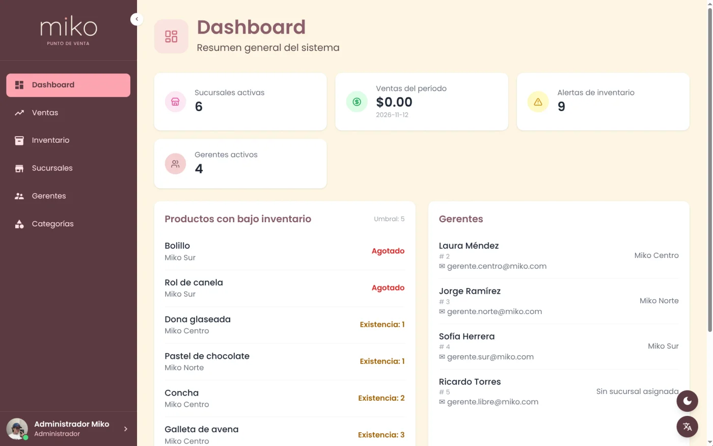 | 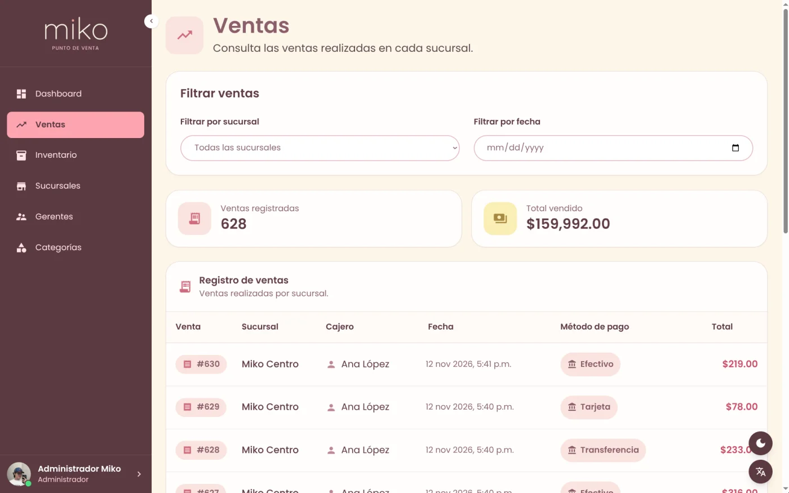 |
 
| Inventario | Sucursales |
|---|---|
| 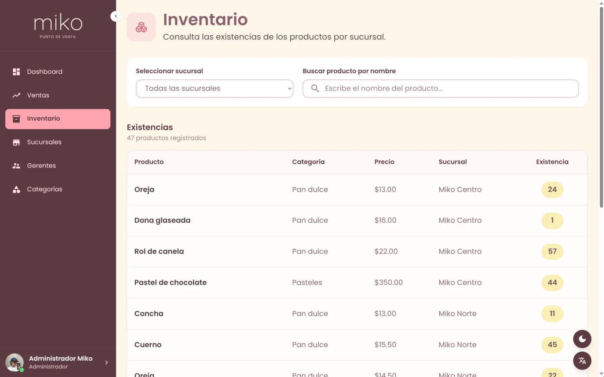 | 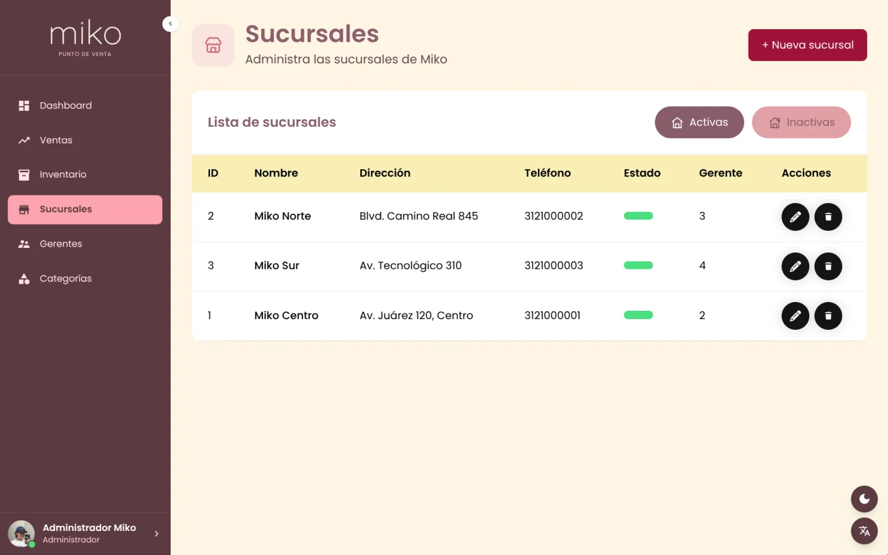 |
 
### Gerente de sede
 
| Dashboard | Inventario |
|---|---|
| 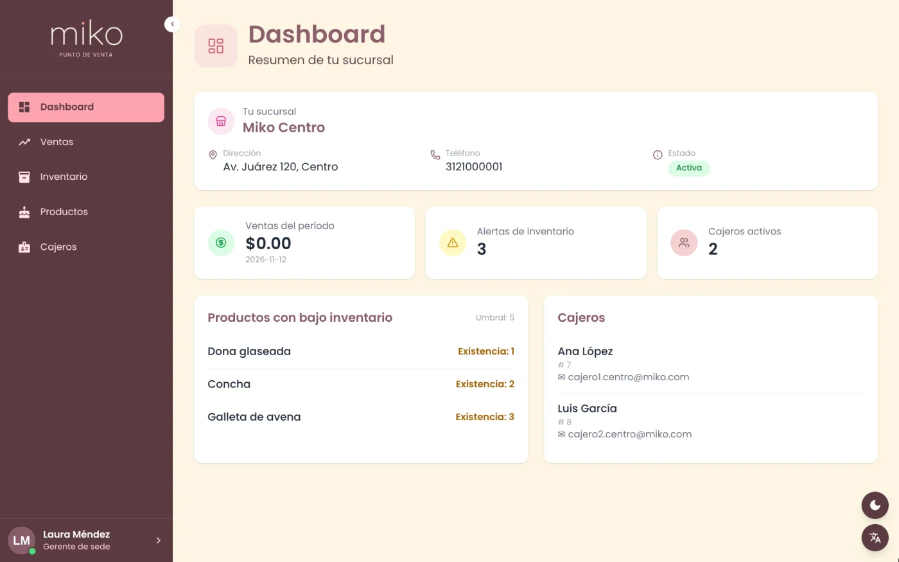 | 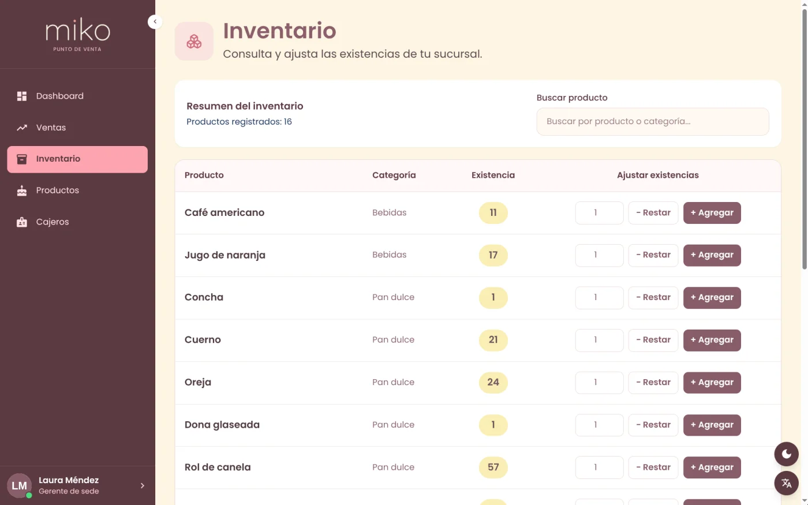 |
 
| Productos | Cajeros |
|---|---|
| 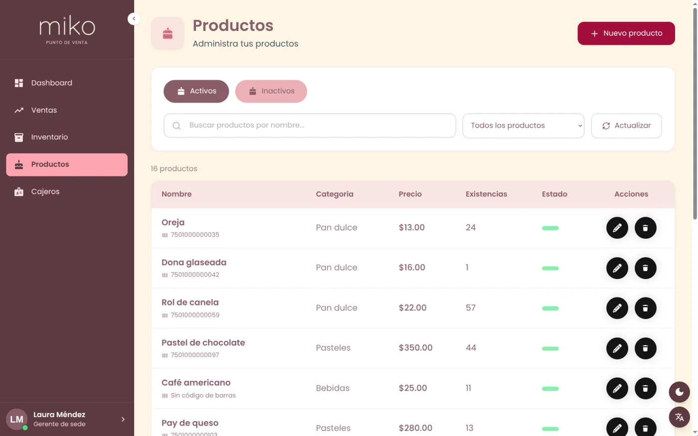 | 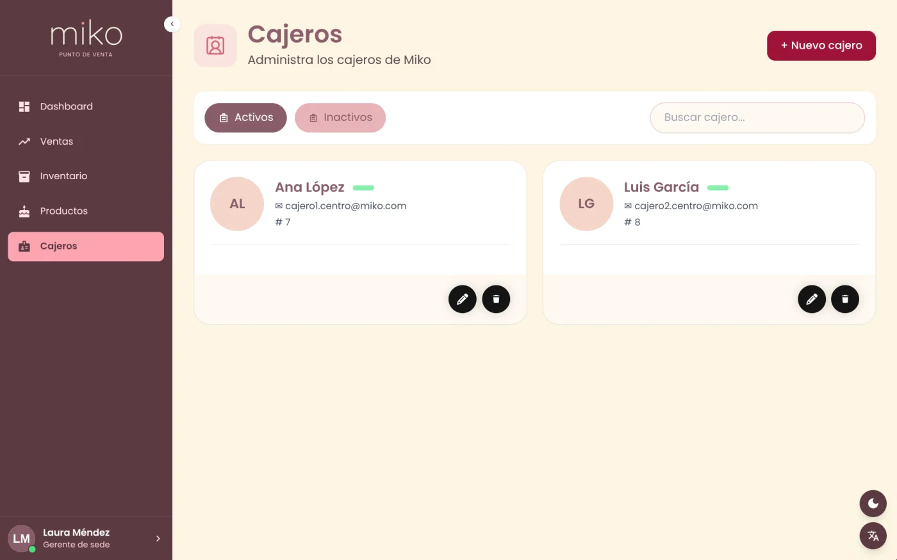 |
 
### Cajero
 
| Punto de venta (claro) | Punto de venta (oscuro) |
|---|---|
| 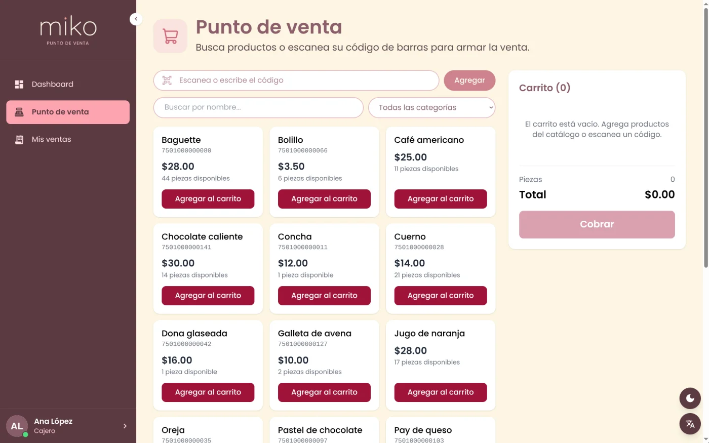 | 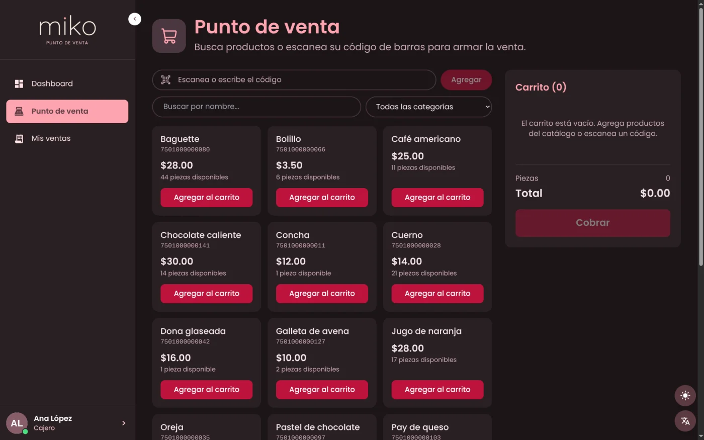 |
 
| Mis ventas |
|---|
| 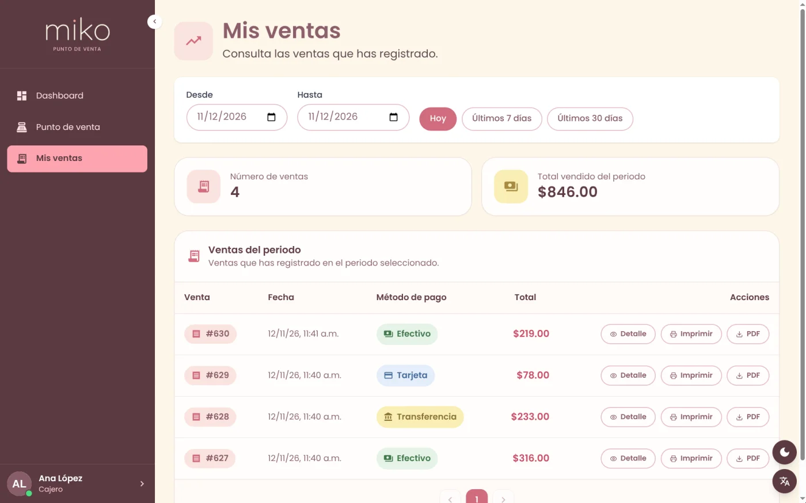 |

## 🛠️ Guía de instalación

### Requisitos previos

- Docker instalado y corriendo (con Docker Compose plugin)
- Git

No necesitas instalar Python, Node ni PostgreSQL en tu máquina — todo corre dentro de los contenedores.

### Paso 1: Clonar el repositorio y entrar a la carpeta

```bash
git clone https://github.com/diegoa-mg/Miko.git
cd Miko
```

### Paso 2: Crear archivos .env

```bash
cp .env.example .env
cp frontend/.env.example frontend/.env
```

### Paso 3: Generar la `JWT_SECRET_KEY`

La clave con la que el backend firma los tokens de sesión debe ser larga y aleatoria. Genera una con:

```bash
docker run --rm python:3.12-slim python -c "import secrets; print(secrets.token_hex(32))"
```

Copia el resultado en tu `.env`:

```
JWT_SECRET_KEY=<la_clave_generada>
```
>⚠️ Cada integrante genera su propia clave; nunca la subas a GitHub ni la pongas en .env.example

### Paso 4: Agregar la URL del proyecto y la Secret Key de Supabase al .env
La URL está en Supabase > Project Overview, debajo del nombre del proyecto. La clave está en Project Settings > API Keys > Publishable and secret API keys > Secret keys. Usa la clave secreta, nunca la publishable.
```
SUPABASE_URL=https://tu-proyecto.supabase.co
SUPABASE_SERVICE_KEY=cambia-esto-por-la-clave-secreta-de-supabase
```
>⚠️ Nunca subas la Secret Key a GitHub ni la pongas en .env.example

### Paso 5: Levantar los contenedores
```bash
docker compose up -d
```

### Paso 6: Aplicar migraciones de Alembic
```bash
docker compose exec backend alembic upgrade head
```

### Paso 7: Crear el usuario admin de prueba 
```bash
docker compose exec backend python -m scripts.datos_de_prueba
```

Esto crea un usuario Administrador General para poder iniciar sesión:

| Correo | Contraseña |
|---|---|
| `admin@miko.com` | `Miko.12345` |

>⚠️ Estas credenciales son **solo para desarrollo local**. No uses este script en el servidor de producción.

Verifica que los 4 contenedores estén `Up` con `docker compose ps`, y abre:

| Servicio | URL |
|---|---|
| Frontend | http://localhost:5173 |
| Backend (API) | http://localhost:8000 |
| Documentación de la API (Swagger) | http://localhost:8000/docs |
| Mailpit (bandeja de correos de prueba) | http://localhost:8025 |

### Correos en desarrollo (Mailpit)

Miko envía correos (recuperación de contraseña, verificación de correo y aviso de privacidad). En desarrollo **no se envía nada a internet**: el contenedor de [Mailpit](https://mailpit.axllent.org/) captura todos los correos y los muestra en una bandeja local en http://localhost:8025. Así puedes probar los enlaces sin usar un correo real.

No necesitas configurar nada: las variables `SMTP_*` ya traen valores por defecto que apuntan a Mailpit (servidor `mailpit`, puerto `1025`).

| Variable | Valor en desarrollo | Para qué sirve |
|---|---|---|
| `SMTP_HOST` | `mailpit` | Servidor de correo |
| `SMTP_PORT` | `1025` | Puerto SMTP |
| `SMTP_USER` / `SMTP_PASSWORD` | vacíos | Solo se usan con un SMTP real |
| `SMTP_FROM` | `no-reply@miko.com` | Remitente de los correos |
| `FRONTEND_URL` | `http://localhost:5173` | Base de los enlaces que llevan los correos |

>⚠️ Los correos que ves en Mailpit nunca llegan a una bandeja real y se pierden al reiniciar el contenedor. Para producción hay que cambiar los valores `SMTP_*` por los de un proveedor real y guardarlos solo en variables de entorno, nunca en el repositorio.

>⚠️ No modifiques el `Dockerfile` del frontend sin saber por qué está así — usa una versión específica de Node y pnpm a propósito; cambiarlo rompe el build para todo el equipo.

## 📂 Estructura del proyecto

```
Miko/
├── docker-compose.yml          # db, mailpit, backend y frontend
├── .env.example                # plantilla de variables de entorno (raíz)
├── .gitignore
├── README.md
├── docs/
│   └── capturas/               # capturas de pantalla del README (.webp)
├── backend/
│   ├── Dockerfile
│   ├── requirements.txt
│   ├── alembic.ini
│   ├── alembic/
│   │   ├── env.py              # conecta Alembic con los modelos y la BD
│   │   └── versions/           # migraciones (esquema + datos iniciales)
│   ├── assets/                 # aviso_de_privacidad.pdf (se adjunta al correo)
│   ├── scripts/                # datos de prueba y scripts de test manual
│   └── src/
│       ├── main.py             # punto de entrada de FastAPI
│       ├── database.py         # engine, sesión y Base de SQLAlchemy
│       ├── security.py         # hash de contraseñas y manejo de JWT
│       ├── auth.py
│       ├── dependencies.py     # dependencias de FastAPI (usuario actual, roles)
│       ├── models/             # tablas (SQLAlchemy 2.0)
│       │   ├── usuarios.py     # Rol, Usuario
│       │   ├── sucursales.py
│       │   ├── categorias.py
│       │   ├── productos.py
│       │   ├── inventarios.py
│       │   └── ventas.py       # MetodoPago, Venta, DetalleVenta
│       ├── schemas/            # esquemas Pydantic (entrada/salida de la API)
│       ├── repositories/       # acceso a datos (usuarios)
│       ├── routers/            # endpoints: auth, cuenta, aviso_privacidad,
│       │                       # sucursales, gerentes, cajeros, categorias,
│       │                       # productos, productos_cajero, inventarios,
│       │                       # ventas, dashboard y dashboard_cajero
│       └── services/           # lógica de negocio (usuarios, sucursales,
│                               # productos, inventarios, ventas, fotos,
│                               # fechas, correo, recuperacion_password,
│                               # pdf_ticket)
└── frontend/
    ├── Dockerfile
    ├── package.json
    ├── pnpm-lock.yaml
    ├── pnpm-workspace.yaml     # aprueba el script nativo de esbuild
    ├── .npmrc
    ├── vite.config.js
    ├── tailwind.config.js
    ├── postcss.config.js
    ├── index.html
    ├── public/                 # favicon.png (ícono de la pestaña del navegador)
    ├── .env.example            # plantilla de variables de entorno (frontend)
    └── src/
        ├── main.jsx
        ├── App.jsx             # rutas y pantalla de inicio de sesión
        ├── i18n.js
        ├── index.css
        ├── api/                # llamadas al backend (axios.js es la instancia base)
        ├── assets/             # logos e ícono
        ├── components/         # Sidebar, LanguageSwitcher, ThemeToggle,
        │                       # CobroModal, TicketVentaModal, Paginacion, etc.
        ├── context/            # AuthContext (sesión) y ThemeContext (modo oscuro)
        ├── layouts/            # AdminLayout, GerenteLayout, CajeroLayout
        ├── pages/              # pantallas: dashboards, sucursales, gerentes,
        │                       # cajeros, categorías, productos, inventarios,
        │                       # ventas, punto de venta, configuración,
        │                       # recuperar/restablecer contraseña, aviso de
        │                       # privacidad y confirmación de correo
        ├── routes/             # ProtectedRoute y RoleRoute (acceso por rol)
        └── locales/
            ├── es/translation.json
            └── en/translation.json
```

## 👤 Equipo de desarrollo

| Integrante | GitHub |
|---|---|
| Diego Morales | [@diegoa-mg](https://github.com/diegoa-mg) |
| Luis Ramírez | [@luisfer-rv](https://github.com/luisfer-rv) |
| Darinka Contreras | [@darimonc](https://github.com/darimonc) |
| Francisco Espitia | [@fespitia01](https://github.com/fespitia01) |
| Miguel Orozco | [@MigueSsj](https://github.com/MigueSsj) |
